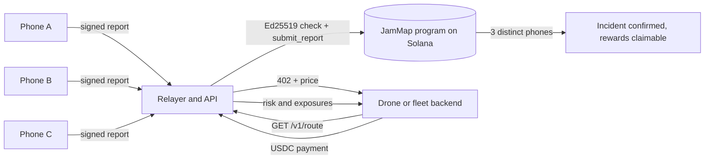

<p align="center"></p>

# JamMap

JamMap detects GPS jamming and spoofing with ordinary Android phones, confirms each incident on Solana once several independent phones agree, and sells the resulting ground-level map to drone, fleet and insurance software, paid per request in USDC.

## Problem

GNSS interference has spread well beyond conflict zones. IATA reports that GPS jamming rose 67% and spoofing 193% between 2023 and 2025, and spoofing affected up to about 1,500 flights a day in 2024 ([summary](https://migflug.com/afterburner/gps-spoofing-up-193-pilots-are-flying-blind/), [white paper](https://gpswise.aero/white_paper.pdf)).

Public interference maps are built from aircraft position reports, so they only cover the sky above airways. Drones, delivery vehicles, trucks and tractors steered by GPS operate on the ground, where those maps have no data.

## How it works

1. **Detect.** The Android app reads raw GNSS measurements once per second: signal-to-noise per satellite (C/N0) and receiver automatic gain control (AGC). Jamming lowers both. A phone that is simply blocked (pocket, tunnel, metal box) loses signal but *raises* its gain, so it is never reported. Spoofing shows up as unusually strong, uniform satellites with lower gain, or as an impossible jump in position. Method follows [Android's guidance](https://developer.android.com/develop/sensors-and-location/sensors/gnss-spoof-jam).
2. **Confirm.** The phone signs a 34-byte report with its own ed25519 key. A relayer pays the transaction fee, but the Solana program verifies the *phone's* signature through the native Ed25519 program, so the relayer cannot forge or edit reports. An incident (≈5 km zone × 5-minute window) is confirmed only when **3 distinct registered phones** report it, and each phone can vote once.
3. **Reward.** Every phone that reported a confirmed incident can claim JAM tokens from an on-chain vault.
4. **Sell.** Customers query risk around a point or along a route. The API answers `402 Payment Required`; the client pays 0.01 USDC on Solana and repeats the request with the payment attached ([x402](https://www.x402.org)). No account or API key is needed, which suits drone autopilots and fleet backends.

JamMap only listens. It never transmits, and the demo never uses a jammer. Operating one is illegal in most countries.

## Product

| | |
|---|---|
| **Live map** | Confirmed and unconfirmed zones, online sensors, report feed with links to each Solana transaction |
| **Incident evidence** | Per-sensor C/N0 and AGC changes plotted against the jamming / spoofing / blocked regions, estimated source location with accuracy, on-chain record |
| **Route check** | Pick A and B on the map: risk score and which parts of the route cross interference (paid, x402) |
| **Data API** | `GET /v1/risk`, `GET /v1/route` (paid), `GET /v1/map` (free) |
| **Android app** | Live signal chart, detector state, signed reports, test mode that injects a synthetic jammer signature without any radio |

## Repository

| Path | Contents |
|---|---|
| `programs/jammap` | Anchor program: device registry, Ed25519-verified reports, quorum, reward vault |
| `tests/jammap.ts` | Program tests: quorum, duplicate vote, wrong signer, tampered field, single claim |
| `server/` | Relayer and API (Node, no framework): signature and measurement checks, x402 paywall, source localization, route exposure |
| `server/src/sim.js` | 17 simulated phones running the same detector: a jammer, a spoofer, a phone in a metal box and a dishonest reporter |
| `server/src/buyer.js` | x402 client used by a customer backend |
| `web/` | Dashboard (vanilla JS + Leaflet, light and dark themes) |
| `android/` | Kotlin app |



## Security model and limits

- The program checks that the instruction before `submit_report` is an Ed25519 verification of exactly `domain ‖ zone ‖ timestamp ‖ kind ‖ severity` by the registered device key, with all data inline.
- The relayer re-runs the detector on the measurements a phone sends and rejects reports whose numbers do not support the claim.
- Only ≈5 km zones go on-chain; exact positions stay with the relayer, and the public map rounds sensors to ≈500 m.
- **Not solved yet:** one person running many phones. Quorum raises the cost but does not prevent it. Next steps are Android Key Attestation / Play Integrity and stake per device.
- Phones that do not expose AGC never report. Source localization is a weighted centroid; a path-loss fit is next.

## Landscape

| | Data source | Ground level | Verifiable record |
|---|---|---|---|
| [GPSJam](https://gpsjam.org) and flight-tracker interference maps | Aircraft ADS-B accuracy reports | No | No |
| Satellite RF monitoring (e.g. [HawkEye 360](https://www.he360.com)) | Satellites | Partly, sold to governments | No |
| [GEODNET](https://geodnet.com), [Onocoy](https://www.onocoy.com) | Fixed reference stations | Yes, for positioning corrections | Token rewards, not interference |
| **JamMap** | Phones people already carry | Yes | Each confirmed incident on Solana |

## Pitch deck and videos

- Pitch deck: https://claude.ai/artifact/WP6sYE6wS667MmrC35LDj9 (export to PDF and add to `docs/` before submitting)
- Pitch video script: [docs/PITCH-VIDEO-SCRIPT.md](docs/PITCH-VIDEO-SCRIPT.md)
- Demo video script: [docs/DEMO-VIDEO-SCRIPT.md](docs/DEMO-VIDEO-SCRIPT.md)
- Full setup: [docs/SETUP.md](docs/SETUP.md)

## Run locally (5 minutes, no blockchain required)

```bash
cd server
npm install
npm run demo        # relayer and dashboard on http://localhost:8787
npm run sim         # second terminal: simulated phones
node src/buyer.js --demo --lat 42.32 --lon 69.62
npm test
```

## Run on Solana devnet

```bash
anchor build && anchor keys sync && anchor build
anchor test
anchor deploy --provider.cluster devnet
cd server && JAMMAP_PROGRAM_ID=<id> npm run setup:devnet
# add JAMMAP_PROGRAM_ID and RELAYER_KEYPAIR to server/.env
npm run demo && npm run sim
npm run buy -- --lat 42.32 --lon 69.62      # real devnet USDC payment
```

## Android

Open `android/` in Android Studio and run on Android 8 or newer. AGC is exposed by most recent flagship chipsets (Pixel 5 and later, Galaxy S21 and later are good candidates). Enter the relayer address (`http://<laptop LAN IP>:8787`) and a Solana address for rewards, tap **Register**, then **Start listening**.

## Why Solana

Thousands of phones reporting every few minutes need fees well below a cent. Native Ed25519 verification lets phones without SOL or a wallet produce data the chain can check. USDC and x402 turn a data sale into one HTTP round trip.

## License

MIT
